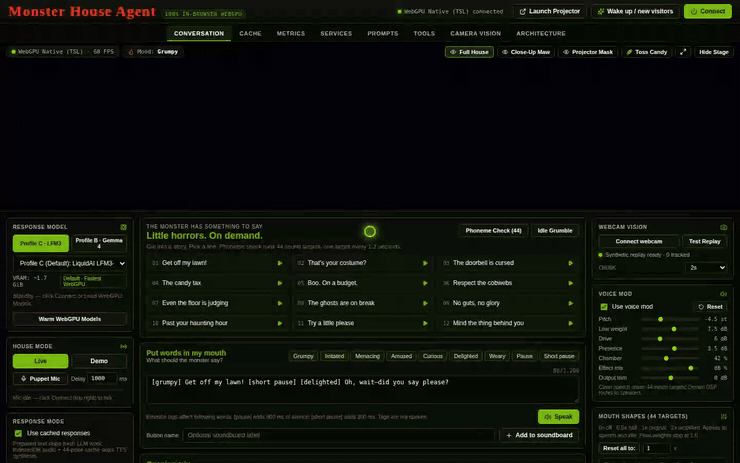

# MonsterHouse WebGPU — *"Boo! Now Get Off My Lawn!"*

A 100% client-side, end-to-end **WebGPU** implementation of NVIDIA's [MonsterHouse (*Building a Haunted House with NVIDIA Nemotron Open Models*)](https://huggingface.co/blog/nvidia/nemotron-halloween), featuring upgraded real-time **Three.js WebGPU (`three/webgpu`) + TSL (`three/tsl`)** volumetric hellfire visuals, 44-target ARKit splintered pirate-ship garage-door lip-sync, dual-stream WebAudio monsterization, and ByteTrack + VLM trick-or-treater costume awareness.

Zero Python servers, zero cloud API keys, and zero external runtimes required—every model, DSP chain, tracker, cache, and 3D shader runs directly in your browser.

- 📝 **Technical Deep-Dive Blog Post & Full Play Guide:** [`blog/BLOGPOST.md`](./blog/BLOGPOST.md) *(plus ready-to-paste Blogger HTML in [`blog/BLOGGER_PASTE.html`](./blog/BLOGGER_PASTE.html))*
- 🎬 **Narrated Live Demo Video (3m 42s, 8 Chapters):** [`blog/media/monsterhouse-live-demo.mp4`](./blog/media/monsterhouse-live-demo.mp4)



---

## Highlights

- **Dramatically Upgraded 3D WebGPU Stage (`three/webgpu` + `three/tsl`)**:
  - **24-Plank Splintered Pirate-Galleon Garage Mouth** deformed across all **44 active ARKit sound targets** (`bs_skin_config.json`) with weathered timber grain, iron nail-studs, jagged wooden fangs, and a glowing magma tongue.
  - **Volumetric TSL Hellfire Furnace + 420 Instanced Driveway Embers + Ground Fog** reactive to all 7 inline mood tags (`[grumpy]`, `[irritated]`, `[menacing]`, `[amused]`, `[curious]`, `[delighted]`, `[weary]`).
  - **Full Architectural Haunted House Stage** with stone piers, flickering brass lanterns, jack-o'-lanterns, ghostly upper-story captain silhouette, wet reflective rain-slicked driveway, and physicalized 3D candy bar barrage VFX.
  - **Dual-Window Garage Projector Mode**: Click **Launch Projector** (`?projector=1`) for a frameless 60 FPS `BroadcastChannel`-synced garage-door projection window with 4-corner keystone calibration.
- **Performance-Ordered WebGPU Model Profiles** (`C` Default → `B` Co-Primary → `A` Dropdown Opt-In):
  1. **Profile C (Default — Fastest WebGPU)**: **Liquid AI LFM3-VL 2B** (`onnx-community/LFM3-VL-2B-ONNX` `q4f16`, **only 1.24 GB** for Brain + shared Costume Vision using 75% gated Short-Conv $O(1)$ cache, ~1.7 GiB total stack VRAM) + NVIDIA Parakeet/Nemotron 0.6B CTC WebGPU ASR (`onnx-community/parakeet-ctc-0.6b-ONNX` `q4f16`).
  2. **Profile B (Co-Primary — Multimodal Audio+Vision)**: **Google Gemma 4 E2B Omni** (`onnx-community/gemma-4-E2B-it-ONNX` `q4f16`, ~3.4 GiB VRAM, unified Brain + Vision + direct 16 kHz `audio_encoder_q4f16` speech understanding with 0 extra ASR VRAM), paired with a 1-click **"Benchmark C vs B & Auto-Pick Fastest"** GPU profiler.
  3. **Profile A (Dropdown Opt-In — 8GB+ Desktop)**: **NVIDIA Nemotron-3.5-Bolt-E4B** (`RASMUS/NVIDIA-Nemotron-3.5-Bolt-E4B-ONNX` `q4f16` — NVIDIA's post-trained `gemma4` flagship) + `nvidia/Audio2Face-3D-v2.3-Mark` (`network.onnx`, 75.8 MB).
- **Sub-Second Dual-Shortcut Voice Pipeline**:
  - **Deterministic 10-State Encounter Controller**: Enforces grumpy initial refusal, immediate `"please"` breakthrough + candy launch, 3-turn persistence fallback, `wonOver` visitor memory, and `OpeningMix` probabilities.
  - **Shortcut #1 (Prepared Pirate Dialogue Bank)** & **Shortcut #2 (IndexedDB Audio + 60Hz ARKit Curve Cache)** for sub-10 ms responses on classic trick-or-treat beats.
  - **Dual-Stream Audio Split**: Clean speech drives 60 Hz lip-sync while the audience hears a real-time WebAudio `GranularPitchProcessor` AudioWorklet (-4.5 semitones, low-shelf weight, asymmetric wave-shaper grit, and haunted ship-hull convolution reverb) plus live **Microphone Possession Mode**.
- **Full 8-Tab MonsterHouse Control Desk**:
  - `CONVERSATION`, `CACHE`, `METRICS`, `SERVICES`, `PROMPTS`, `TOOLS` (*"Sample Your Voice"* zero-shot studio + 44-target phoneme check), `CAMERA VISION` (ByteTrack + 5-costume synthetic replay & live webcam), and `ARCHITECTURE`.

---

## Quickstart

```bash
npm install
npm run dev
```

Open `http://localhost:5173` in Chrome/Edge 128+ with WebGPU enabled:
1. Click **Connect** (or click any **Soundboard** tile immediately—MonsterHouse works at zero wait even before multi-GB WebGPU weights finish streaming, then seamlessly upgrades to live WebGPU inference!).
2. Try typing or speaking `"Trick or treat! Give us candy!"` (grumpy pirate refusal) followed by `"Trick or treat, may we please have some candy?"` (immediate breakthrough + 3D candy barrage!).
3. Open **CAMERA VISION** to watch live ByteTrack multi-person tracking + Omni Observer costume identification (or toggle **Live Webcam**).

---

## Scripts

```bash
npm run dev        # Start Vite dev server with COOP/COEP WebGPU isolation headers
npm run typecheck  # Strict TypeScript verification
npm run lint       # ESLint verification
npm run test       # Run Vitest unit test suites
npm run build      # Production bundle build
```
