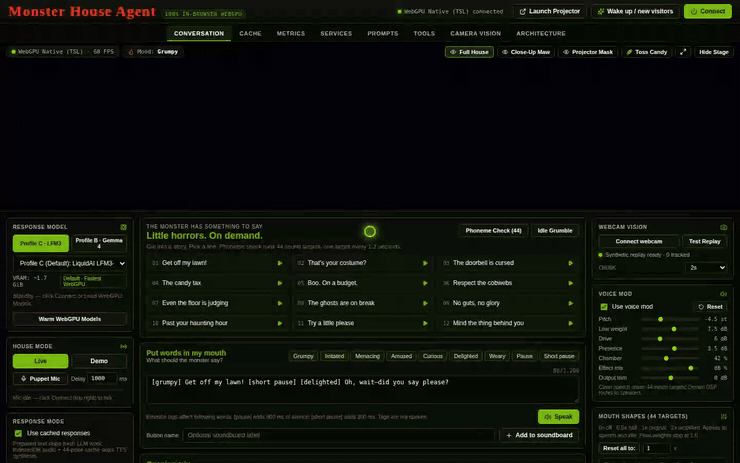
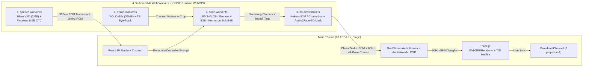
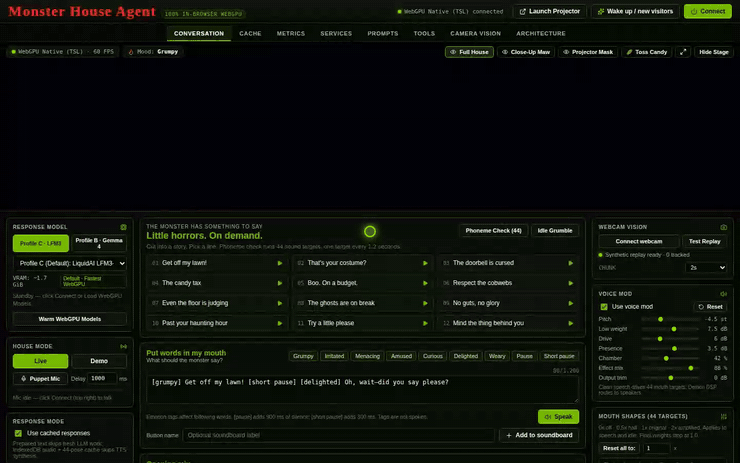
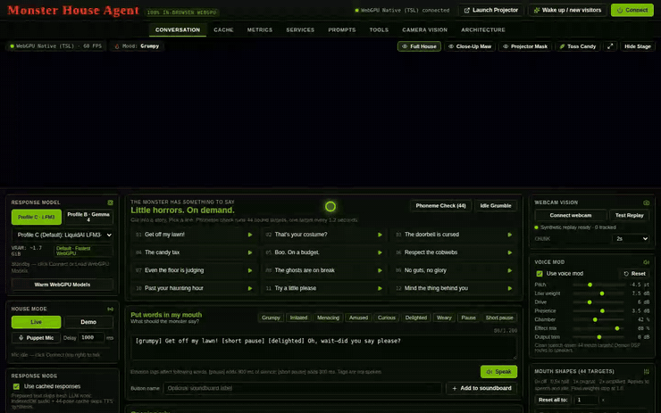
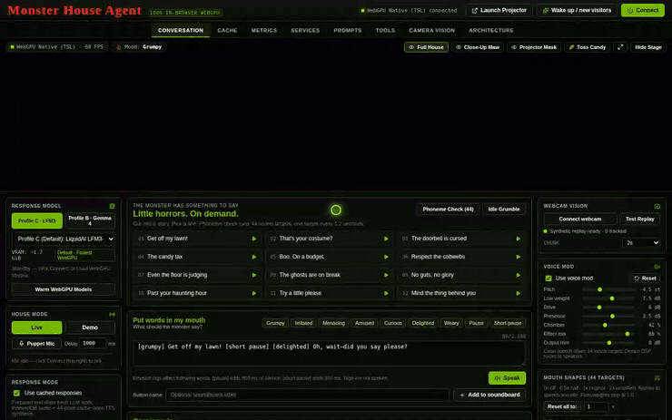
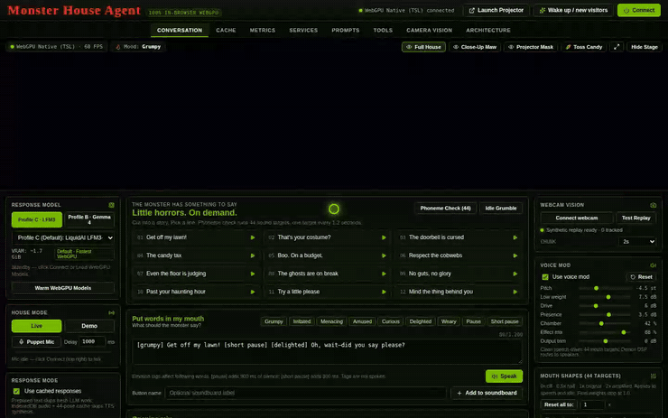
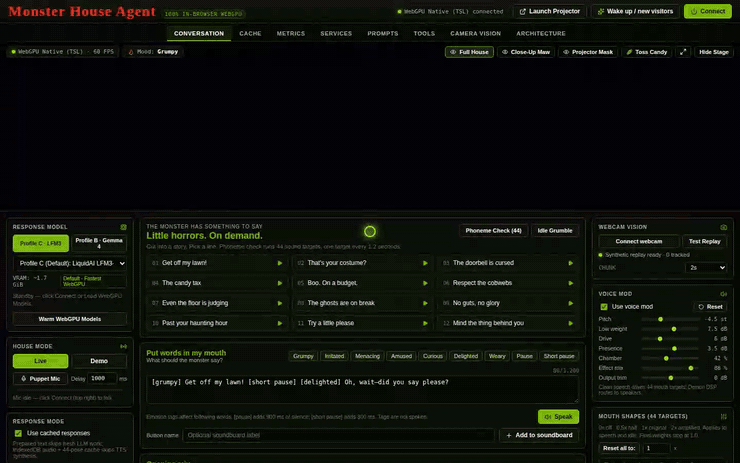
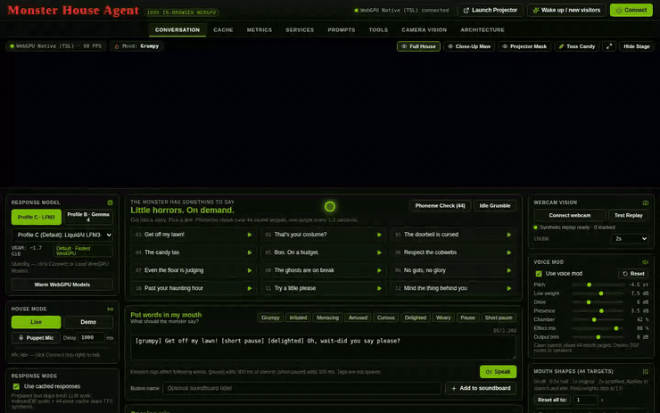
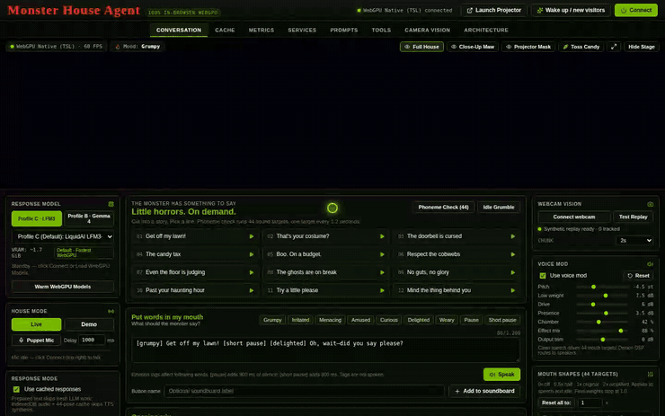

# Boo! Now Get Off My Browser Tab! Rebuilding NVIDIA’s Nemotron Haunted House 100% Locally on WebGPU

> **On-Device WebGPU · Voice & Vision Agents · Halloween Build**
>
> **Source Code:** [github.com/rabimba/monsterhouse-webgpu](https://github.com/rabimba/monsterhouse-webgpu) · **Narrated Live Demo Video (3m 42s):** [monsterhouse-live-demo.mp4](./media/monsterhouse-live-demo.mp4) · **Original Inspiration:** [NVIDIA’s *Boo! Now Get Off My Lawn! Building a Haunted House with NVIDIA Nemotron Open Models*](https://huggingface.co/blog/nvidia/nemotron-halloween)

When the NVIDIA team published [*Boo! Now Get Off My Lawn! Building a Haunted House with NVIDIA Nemotron Open Models*](https://huggingface.co/blog/nvidia/nemotron-halloween) on Hugging Face, it immediately stood out as one of the most joyful physical AI builds of the year. Instead of putting another polite chatbot inside a text box, they projected a grumpy, splintered sunken pirate ship onto a real suburban garage door—giving it live speech recognition, webcam costume detection, stateful trick-or-treat comedic timing, neural lip-sync via `Audio2Face-3D`, and a physical candy chute that only dispensed full-size bars once trick-or-treaters showed some manners and said *"please"*.

Looking at their system diagram, however, sparked the exact WebAI question I can never resist asking. Running the original setup meant orchestrating local Python servers, FastRTC WebRTC audio relays, desktop CUDA containers, multi-GPU VRAM budgets, and an external Maya/Omniverse blendshape rig.

> [!IMPORTANT]
> **The Single-Tab WebGPU Challenge:** What happens if you strip away every Python microservice, every WebRTC signaling server, and every cloud API key, and rebuild the entire haunted house—streaming VAD, speech recognition, multi-visitor costume tracking, pirate persona reasoning, zero-shot voice conditioning, 60 Hz 44-target ARKit facial animation, Dual-Stream Demon DSP, and volumetric furnace fire—to run **100% client-side inside a single browser tab over WebGPU**?

That question turned into **[MonsterHouse WebGPU](https://github.com/rabimba/monsterhouse-webgpu)**: an open-source, zero-backend haunted house studio where anyone with Chrome or Edge, a laptop GPU, a webcam, and a backyard projector can turn their garage door into an autonomous trick-or-treat monster in thirty seconds flat.

---

## Watch the Full Narrated Live Demo (3m 45s)

Before diving into the WebGPU worker architecture and shader math, watch the full **3-minute 45-second narrated live walkthrough** (turn audio on!) covering every single tab, model profile, costume roast, shader uniform, and dual-window garage projector calibration:

<video controls playsinline preload="metadata" poster="https://cdn.jsdelivr.net/gh/rabimba/monsterhouse-webgpu@main/blog/media/monsterhouse-demo-poster.jpg" width="100%">
  <source src="https://cdn.jsdelivr.net/gh/rabimba/monsterhouse-webgpu@main/blog/media/monsterhouse-live-demo.mp4" type="video/mp4" />
  <a href="./media/monsterhouse-live-demo.mp4">Watch / Download Narrated Live Demo (monsterhouse-live-demo.mp4)</a>
</video>

> **Video Chapters:** `0:00` 3D Stage & TSL Hellfire · `0:33` Trick-or-Treat & *"Please"* Breakthrough · `1:01` Soundboard, Inline Tags & Puppet Mic · `1:29` Profiles C/B/A & Demon DSP · `2:06` YOLOv10s + ByteTrack Costume Roast · `2:33` Prompts & Shader Tuner · `2:56` Zero-Shot Voice & `?projector=1` · `3:24` Cache, Metrics & Architecture
> *(Direct file: [`./media/monsterhouse-live-demo.mp4`](./media/monsterhouse-live-demo.mp4))*


*Figure 1: The Three.js WebGPU Haunted House stage running at 60 FPS—featuring 24 splintered pirate-ship planks deformed by 44 ARKit targets, 3-layer TSL volumetric hellfire, Close-Up Maw and Projector Mask camera presets, and physics-driven full-size candy launches onto a rain-slick driveway.*

---

## 1. Collapsing a Multi-GPU Python Stack into 5 Browser Web Workers

In a native desktop installation, keeping 60 FPS graphics smooth while running speech, vision, and LLM inference is straightforward: you pin services to separate processes or separate GPUs. Inside a browser tab, naive main-thread inference freezes `requestAnimationFrame` the moment an ONNX session dispatches a heavy prefill shader.

To keep our Three.js WebGPU stage locked at **60 FPS** with zero UI jank, we partitioned the entire application into **five isolated execution lanes** backed by `Cross-Origin-Opener-Policy: same-origin` and `Cross-Origin-Embedder-Policy: require-corp` (`SharedArrayBuffer`-enabled WASM + WebGPU threads):



### Choosing the Right Browser Model Stack: Profile C, Profile B, and Profile A

Desktop haunted houses can casually load 16+ GB of bf16 weights. Browser tabs live inside Dawn/wgpu buffer limits and consumer laptop VRAM. In `src/ai/modelRegistry.ts`, we engineered **three switchable hardware profiles**—making **Profile C** and **Profile B** one-click co-primary buttons in the left sidebar while keeping NVIDIA’s heavier **Profile A** available in the Services dropdown for 8 GB+ desktop GPUs:

| Profile | Role in UI | Brain + Vision Model (`q4f16`) | Speech Listener (VAD + ASR) | Voice + 44-Pose Rig | Est. VRAM |
| :--- | :--- | :--- | :--- | :--- | :--- |
| **Profile C** *(Default)* | Sidebar Co-Primary | **Liquid AI `LFM3-VL-2B-ONNX`** (`1,236 MB` shared Brain + Vision; 75% gated Short-Conv `O(1)` decode) | `Silero VAD` (`2 MB`) + `NVIDIA Parakeet 0.6B CTC` (`433 MB`) | `Kokoro-82M` (`86 MB`) + `Audio2Face-3D v2.3 Mark` (`76 MB`) | **~1.7 GiB** |
| **Profile B** *(Omni)* | Sidebar Co-Primary | **Google `Gemma 4 E2B-it ONNX`** (`3,224 MB` unified Text + Vision + Audio) | `Silero VAD` + **Gemma 4 Native 16 kHz Audio Encoder** (`0 MB` extra ASR!) | `Kokoro-82M` / `Chatterbox` + `Audio2Face-3D v2.3 Mark` | **~3.4 GiB** |
| **Profile A** *(Desktop)* | Services Dropdown | **`NVIDIA Nemotron 3.5 Bolt E4B`** (`4,678 MB` `q4f16` ONNX) + optional `LFM3-VL` subagent | `Silero VAD` + `NVIDIA Parakeet 0.6B CTC` (`433 MB`) | `Chatterbox Zero-Shot` (`539 MB`) + `Audio2Face-3D v2.3 Mark` | **~5.8 GiB** |

Why does **Profile C (`LFM3-VL 2B`)** feel so snappy on integrated laptop GPUs? Standard transformer decoders pay quadratic attention KV-cache bandwidth penalties as system prompts, visitor costume metadata, and multi-turn history grow. Liquid AI’s hybrid architecture replaces 75% of attention layers with gated **Short-Conv** blocks that maintain a tiny fixed-size `O(1)` state—giving us multimodal vision + fast token streaming in **1.24 GB** of weights. Meanwhile, **Profile B (`Gemma 4 E2B Omni`)** eliminates separate ASR weights altogether by feeding 16 kHz microphone audio directly into Gemma 4’s native `audio_encoder_q4f16` alongside porch camera crops.

We also staged worker initialization (`bootAllWorkers` in `src/store/useMonsterStore.ts`) so `Silero VAD` (`2 MB`) comes online immediately in Stage 1 while heavy `Parakeet 0.6B CTC` (`433 MB`) waits in queue until `brain.worker.ts` finishes streaming its quantized `.onnx_data` shards—preventing multi-gigabyte HTTP/2 contention on cold boot.


*Figure 2: Switching live between co-primary Profile C (`LFM3-VL 2B`) and Profile B (`Gemma 4 E2B Omni`), inspecting the 5 worker slots and Profile A (`Nemotron Bolt E4B`) in Services, and tuning the Dual-Stream Demon DSP rack.*

---

## 2. The Trick-or-Treat State Machine & Our Two Sub-Second Latency Shortcuts

One of the sharpest insights in NVIDIA’s original post is that **small real-time models should improvise pirate flavor, not manage game state**. If you rely on a 2B quantized LLM’s attention window to remember whether a kid already said *"please"*, how many times it refused them, or whether candy was already dispensed, a noisy driveway quickly derails the bit.

In `src/orchestrator/EncounterController.ts`, we implemented a deterministic **10-state Trick-or-Treat finite-state machine** (`IdleSelfTalk`, `WarmGreeting`, `GrumpyGreeting`, `FirstRefusal`, `GrumpyBanter`, `AnswerPlusCandy`, `GivingIn`, `WarmFollowUp`, `GrudgingFollowUp`, `Goodbye`):

1. **Demand candy greedily** (*"Trick or treat! Give us candy!"*) → Transitions deterministically to `FirstRefusal` (`[grumpy]`, `dispenseCandy: false`), scolding the visitors to mind their manners on a haunted galleon.
2. **Say the magic word (`"please"`)** → `POLITE_REGEX` triggers an immediate **`GivingIn` breakthrough** (`[delighted]`, `dispenseCandy: true`, `wonOver: true`), erupting golden furnace sparks and launching spinning full-size candy bars onto the driveway.
3. **Say thank you / Happy Halloween** → Transitions cleanly to `Goodbye` for a warm pirate send-off.


*Figure 3: Connecting the live encounter loop—greedy candy demands trigger `FirstRefusal` (`0` treats), saying `"please"` triggers an immediate `GivingIn` breakthrough and 3D candy barrage, and thanking the house triggers `Goodbye`.*

### Cutting Turnaround Latency Below 50ms–800ms

Even with `q4f16` WebGPU shaders, waiting for a full paragraph of LLM tokens before starting TTS and facial solving kills comedic timing. We combined two architectural shortcuts to make the house feel alive:

1. **Prepared Dialogue Bank + IndexedDB 60 Hz Curve Cache (`src/cache/responseCache.ts`):** Canonical beats (opening greetings, first refusals, soundboard cuts) can pull from our authored pirate script bank (`piratePersonaBank.ts`). Every synthesized line—along with its `Float32Array` 24 kHz PCM waveform and pre-solved 60 Hz 44-target ARKit animation curves—is persisted in IndexedDB (`monsterhouse_idb_v2`). Cache hits replay in **under 50 ms** with zero GPU compute.
2. **Streaming Clause Accumulator & Inline Emotion Tags (`src/orchestrator/emotionTagParser.ts`):** When the WebGPU Brain improvises a fresh roast, `StreamingClauseAccumulator` buffers incoming tokens, strips any internal `<think>...</think>` reasoning blocks, extracts inline stage directions like `[grumpy]`, `[menacing]`, `[delighted]`, and `[short pause]`, and flushes **clause #1** to `tts-a2f.worker.ts` at the very first punctuation boundary while the LLM is still decoding clause #2:

```ts
// Inline tags reshape prosody, mouth sneer, and TSL flame colors mid-utterance—never spoken aloud!
"[grumpy] Who steps on me planks?! [short pause] [menacing] Stand back... [delighted] Just kidding, catch a treat!"
```


*Figure 4: Triggering instant Soundboard tiles, authoring a custom multi-mood line with `[grumpy]`, `[short pause]`, `[menacing]`, and `[delighted]` tags in Put Words In My Mouth, and toggling between `Live`, `Demo`, and real-time `Puppet Mic` possession.*

---

## 3. Dual-Stream Demon Audio & Deforming 24 Pirate Planks with 44 Eyeless ARKit Targets

Early in development, we hit a classic audio-driven animation trap: if you take clean TTS speech, pitch-shift it down `-4.5` semitones, saturate it with tube drive, drench it in dark ship-hull convolution reverb, and feed *that* monsterized waveform into `Audio2Face-3D` or a formant analyzer, **the mouth turns to mush**. Heavy sub-bass and 1.85-second reverb tails smear every plosive (`/p/`, `/b/`, `/t/`) and keep the jaw hanging open long after the syllable ends.

In `src/audio/DualStreamAudioRouter.ts`, we solved this by splitting audio into **two synchronized parallel buses**:

- **Stream A (Clean Analytic Bus → 60 Hz 44-Target Mouth Solver):** Unmodified 24 kHz PCM routes directly to NVIDIA `Audio2Face-3D v2.3 Mark` (`network.onnx` taking `[1, 1, 8320]` 16 kHz windows + a 26-dimensional emotion vector) and our zero-latency spectral F1/F2 formant + sibilant solver (`a2fSolver.ts`), producing crisp 60 Hz blendshape frames.
- **Stream B (Monsterized Speaker Bus → `GranularPitchProcessor` `AudioWorklet`):** The exact same buffer plays out through a custom zero-dependency WebAudio DSP chain (`DualStreamAudioRouter.ts`):
  1. **Dual-Grain Hann-Windowed Pitch Shifter (`AudioWorkletProcessor`)** dropping pitch `-4.5` semitones in real time without slowing speech tempo.
  2. **Low-Shelf Sub-Weight (`+7.5 dB` @ `115 Hz`)** + **Asymmetric Ship-Timber WaveShaper Saturation (`+6.0 dB`)** + **Presence Bite (`+3.5 dB` @ `2.4 kHz`)** so consonants stay intelligible outdoors.
  3. **Procedural Sunken-Hull Convolution Reverb** with early oak-plank slapback reflections at `38 ms` and `79 ms`.

```ts
// Inside GranularPitchProcessor (AudioWorklet): dual 180°-out-of-phase Hann grains
const phaseB = (this.phase + 0.5) % 1;
const winA = 0.5 - 0.5 * Math.cos(2 * Math.PI * this.phase);
const winB = 0.5 - 0.5 * Math.cos(2 * Math.PI * phaseB);
const outSample =
  this.readInterp(this.writeIndex - this.phase * this.grainSize) * winA +
  this.readInterp(this.writeIndex - phaseB * this.grainSize) * winB;
```

### Why 44 ARKit Targets Instead of 52?

Standard ARKit facial rigs output 52 blendshapes, including 8 eye-blink and gaze poses (`eyeBlinkLeft`, `eyeLookInRight`, etc.). **A haunted garage door has no eyeballs.** Following NVIDIA’s `bs_skin_config.json` design, we mask the 8 ocular poses to `0` and map the **44 active vocal & snarl targets** (`jawOpen`, `mouthFunnel`, `mouthPucker`, `mouthUpperUpLeft/Right`, `noseSneerLeft/Right`, `tongueOut`, etc.) directly onto **24 procedural weathered-oak pirate planks**, charred inner fangs, glowing ember tips, and a licking magma tongue (`src/stage/SplinteredMouthRig.ts`).

Behind those splintered jaws sits a 3-layer **Three.js Shading Language (TSL)** node shader (`src/stage/HellfireComputeTSL.ts`) compiling directly to WGSL over `three/webgpu`. Every inline mood tag (`[menacing]`, `[delighted]`, `[curious]`) smoothly interpolates the furnace’s `uPrimaryColor`, `uSecondaryColor`, `uRimColor`, `uTurbulence`, and GPU-instanced ember spawn rate—while central `jawOpen` dynamically boosts `uAperture` so the fire roars brighter every time the house shouts!


*Figure 5: Inspecting editable system prompts and state-indexed pirate adapter exemplars in the Prompts tab, then previewing `[menacing]`, `[delighted]`, and `[curious]` TSL volumetric hellfire shader uniforms live on the 3D stage.*

---

## 4. Driveway Echolocation: `YOLOv10s`, `ByteTrack`, and Zero-Extra-VRAM Costume Roasting

A haunted house becomes ten times funnier when it calls out the *exact* kid standing on the driveway: *"Hold fast, tiny Vampire—did ye sail here from Transylvania, and why is that Pirate behind ye eyeing me full-size chocolate?!"*

In `src/ai/workers/vision.worker.ts` and `src/vision/ByteTracker.ts`, our Camera Vision pipeline runs in two decoupled cadences:

1. **Fast Multi-Person Tracking (`YOLOv10s` + TypeScript `ByteTrack`):** `onnx-community/yolov10s` (`32 MB`) detects visitors on WebGPU while our custom two-stage `ByteTracker` (high-confidence `>= 0.45` pass + occluded low-confidence `>= 0.18` recovery pass with IoU + velocity prediction) maintains stable `Visitor #ID` boxes, approach zone (`approaching` vs `porch`), and persistent `wonOver` status across frames.
2. **Periodic VLM Costume Classification (0 MB Extra VRAM):** Every `2s` (configurable `1s` / `2s` / `4s` / `6s`), cropped visitor bounding boxes are sent to `brain.worker.ts`, which reuses the **already-resident `LFM3-VL` or `Gemma 4` vision encoder** to tag each visitor’s costume (`pirate`, `vampire`, `witch`, `skeleton`, `pumpkin`, `ghost`, `superhero`, etc.) and inject live spatial awareness into the next encounter turn.

And because nobody wants to put on a full Halloween costume at their desk just to test computer vision, **Camera Vision boots into a built-in 5-costume synthetic porch canvas** (`Pirate`, `Vampire`, `Witch`, `Pumpkin`, and `Ghost` walking across the driveway) with a one-click **Live Webcam** toggle whenever you want to step in front of your real camera.


*Figure 6: Tracking 5 costumed visitors in Camera Vision via `YOLOv10s` + `ByteTrack`, adjusting VLM sampling cadence, and firing an Echolocation Roast that calls out the tracked costumes on the porch.*

---

## 5. Four Real Browser War Stories from Auditing the Stack

Porting a multi-model audio/vision/graphics installation into a single browser tab surfaced four subtle bugs that are worth sharing for anyone building complex WebGPU agents:

1. **The Prompt-Echo Costume Label Bug (`brain.worker.ts`):** When `vision.worker.ts` sent a visitor crop to the VLM with a system prompt asking for `{"costume": "<1-2 word label>"}`, Transformers.js `model.generate()` returned the full sequence (`prompt_input_ids` + `generated_ids`). Decoding the full tensor caused our JSON regex to match the literal placeholder `"<1-2 word label>"` inside the prompt before reaching the model’s actual answer! Slicing `out.slice(null, [promptLen, null])` before `processor.batch_decode(...)` immediately restored clean costume labels.
2. **Concurrent WebGPU Session Collisions (`enqueueGpuTask`):** Because webcam costume classification runs on a background timer every 2 seconds while voice turns arrive asynchronously from Silero VAD, a background `ANALYZE_COSTUME_CROP` call could overlap mid-decode with `GENERATE_REPLY` on the shared ONNX Runtime WebGPU session—throwing intermittent buffer-lock errors. Wrapping all GPU dispatches in a serialized `enqueueGpuTask` queue (and dropping background costume crops whenever `gpuBusyCount > 0`) eliminated every race condition.
3. **Cold-Boot Fallback Cache Poisoning (`useMonsterStore.ts`):** To make MonsterHouse playable at `t = 0s` before `Kokoro-82M` finishes warming up, early clicks synthesize speech via our zero-download instant acoustic pirate synth. Initially, `responseCache.ts` dutifully cached that fallback audio in IndexedDB—meaning even after `Kokoro-82M` and `Audio2Face-3D` turned green 4 seconds later, clicking that same Soundboard tile replayed the cold-boot fallback forever! Tagging each `CachedPerformanceEntry` with `ttsEngine` and automatically upgrading `'web-speech-fallback'` entries once `services.tts.state === 'ready'` solved it cleanly.
4. **Acoustic Self-Interruption & Mic Feedback Loops (`speech.worker.ts` & `ToolsTab.tsx`):** When the house boomed pirate lines out of laptop speakers, the microphone picked up its own voice and re-triggered Silero VAD. Adding explicit `SET_HOUSE_SPEAKING` echo gating with a `350 ms` room-reverb tail guard silenced self-triggers, while routing `ToolsTab.tsx`’s `ScriptProcessorNode` through a `0.0` `GainNode` prevented live mic monitoring feedback during Zero-Shot voice recording.

---

## 6. Garage-Door Projection Mode (`?projector=1`), Zero-Shot Voice Studio & Telemetry

To project MonsterHouse onto an actual garage door on Halloween night, you want your operator controls indoors on your laptop and **only** the pure-black `#000000` glowing mouth and furnace fire beamed onto the door outside (since projectors treat `#000000` as transparent darkness in night air).

Clicking **Projector** in the top header opens `/?projector=1` in a second frameless window synced at 60 Hz over `BroadcastChannel('monsterhouse_projector_v1')` (`src/stage/ProjectorSync.ts`). From the **Tools** tab on your main screen, you can:

- **Record 3–10s per-emotion voice references (`Sample Your Voice`)** stored in IndexedDB to condition zero-shot pitch, spectral centroid, and timbre per mood (`[grumpy]`, `[menacing]`, `[delighted]`, etc.).
- **Run the 44-Target ARKit Phoneme Sweep**, stepping pose-by-pose (`1.2s` each) across all 24 wooden planks while verifying plank alignment outside.
- **Drag the 4-Corner Keystone Calibration Sliders** (`Top Left`, `Top Right`, `Bottom Left`, `Bottom Right`), applying real-time `clip-path: polygon(...)` corner-pinning across both the stage preview and the live `?projector=1` window so off-axis driveway projectors snap cleanly onto garage paneling.


*Figure 7: Recording a zero-shot voice sample in Tools, running the 44-target ARKit splintered-plank calibration sweep, and warping 4-corner keystone geometry with live `BroadcastChannel` sync to the `?projector=1` window (shown top-right).*

Meanwhile, the **Cache**, **Metrics**, and **Architecture** tabs give you full observability over IndexedDB cached curves, per-turn **EOU-to-First-Audio turnaround latency** (`VAD -> ASR -> Brain -> TTS+A2F`), live **Profile C vs Profile B** GPU benchmarks, and `SharedArrayBuffer` / WebGPU adapter diagnostics.


*Figure 8: Auditioning sub-50ms cached 60 Hz ARKit performances in Cache, inspecting turn-by-turn EOU-to-First-Audio latency and Profile C vs B trade-offs in Metrics, and viewing the interactive 5-tier pipeline in Architecture.*

---

## 7. Hands-On Guide: How to Play With Every Functionality in 5 Minutes

Want to spin up MonsterHouse WebGPU locally and test every single feature yourself? Here is the complete step-by-step tour:

### Quick Start (30 Seconds)

```bash
git clone https://github.com/rabimba/monsterhouse-webgpu.git
cd monsterhouse-webgpu
npm install
npm run dev
```

Open **`http://localhost:5173`** in **Chrome 128+** or **Edge 128+** (with WebGPU enabled). Model weights download once from Hugging Face and persist automatically in your browser’s Origin/Cache Storage for instant offline startups afterward.

### Step-by-Step Feature Tour

1. **Explore the 3D Stage & Camera Angles (Top Viewport):**
   - Click **Close-Up Maw**, **Projector Mask**, and **Full House** in the top-right overlay of the 3D viewport to inspect the 24 weathered pirate planks and TSL hellfire from every angle.
   - Click the **Expand (`⤢`)** button to enter Theater height, and click **Toss Candy** to launch spinning full-size candy bars onto the wet driveway.
2. **Play the Stateful Trick-or-Treat Loop (`CONVERSATION` Tab):**
   - Click **Connect** in the top-right header. MonsterHouse wakes up, greets you, and arms local **Silero VAD** (`300 ms` EOU).
   - Speak into your microphone (or type into the *Simulate Trick-or-Treater Speech* bar):
     - First try demanding candy: `"Trick or treat! Give us candy!"` → Watch the state pill switch to **`FirstRefusal`** (`[grumpy]`, `0` treats).
     - Now be polite: `"Trick or treat, may we please have some candy?"` → Watch **`GivingIn`** fire immediately with golden sparks and a 3D candy barrage!
     - Finish with `"Thank you Monster House, Happy Halloween!"` → Triggers **`Goodbye`**.
3. **Cut In with Soundboard, Inline Tags & Puppet Mic (`CONVERSATION` + Left Sidebar):**
   - Click any of the **12 Soundboard tiles** to interrupt immediately, or type a tagged script in **Put Words In My Mouth**:
     `[grumpy] Who dares knock?! [short pause] [menacing] Step closer... [delighted] Happy Halloween, matey!`
   - Click **Add to soundboard** to save your custom tile, or click **Speak** to perform it live.
   - In the **Left Sidebar**, switch **House Mode** between **`Live`** (autonomous VAD + VLM), **`Demo`** (curated deterministic showcase), and **`Puppet Mic`** (speak into your mic to drive the 3D pirate planks + Demon Voice DSP in real time like a digital puppeteer!).
4. **Compare WebGPU Profiles & Sculpt the Demon Voice (`SERVICES` + Right Sidebar):**
   - Use the **Left Sidebar** quick-buttons to flip between **Profile C (`LFM3-VL 2B`, ~1.7 GiB)** and **Profile B (`Gemma 4 E2B Omni`, ~3.4 GiB)**, or open the **`SERVICES`** tab dropdown to opt into **Profile A (`NVIDIA Nemotron 3.5 Bolt E4B`, ~5.8 GiB)**.
   - In the **Right Sidebar**, toggle **Demon Voice Mod DSP** on/off and drag **Pitch (`-4.5 st`)**, **Sub Weight**, **Timber Drive**, and **Ship-Hull Reverb**, or manually scrub the **44 Active ARKit Mouth Sliders** (`jawOpen`, `mouthFunnel`, `noseSneerLeft`, `tongueOut`) in real time.
5. **Roast Costumes with `YOLOv10s` + `ByteTrack` (`CAMERA VISION` Tab):**
   - Open **`CAMERA VISION`** to see 5 synthetic trick-or-treaters tracked immediately—no camera required.
   - Click **Live Webcam** to switch to your physical camera (`getUserMedia`), stand in frame, wait 1–2 seconds for your green ByteTrack `Visitor #ID` box and VLM costume label, and click **Echolocation Roast** to hear the pirate ship roast what you are wearing!
6. **Tune Persona Prompts & TSL Fire Uniforms (`PROMPTS` Tab):**
   - Edit the live system prompt or toggle the **State-Indexed Pirate Character Adapter** on/off to hear the difference in pirate phrasing.
   - Click **Preview on 3D Stage** on `[menacing]`, `[delighted]`, or `[curious]` and drag the **Turbulence** and **Ember Rate** sliders to sculpt the WGSL furnace flames live.
7. **Clone Your Timbre & Calibrate Your Garage Projector (`TOOLS` Tab + `Projector` Button):**
   - Open **`TOOLS`**, click **Record 3–10s** on any mood card in **Sample Your Voice**, read the pirate line, and click **Activate Zero-Shot Voice**.
   - Click **Projector** in the top header to pop out `/?projector=1`, click **Phoneme check (44 targets)**, and drag the **Projector Keystone Corner-Pin** sliders to watch both windows warp in lockstep.
8. **Audit Sub-50ms Replays & Turnaround Telemetry (`CACHE`, `METRICS`, `ARCHITECTURE` Tabs):**
   - Replay or export cached voice + 60 Hz blendshape performances in **`CACHE`**, inspect your GPU’s EOU-to-First-Audio breakdown in **`METRICS`**, and verify worker health + `SharedArrayBuffer` isolation in **`ARCHITECTURE`**.

---

### Credits & Links

Huge credit to the NVIDIA team behind [*Boo! Now Get Off My Lawn! Building a Haunted House with NVIDIA Nemotron Open Models*](https://huggingface.co/blog/nvidia/nemotron-halloween) for the original sunken-pirate-ship concept, stateful politeness comedy loop, and open `Parakeet`, `Nemotron`, and `Audio2Face-3D` weights—alongside Liquid AI (`LFM3-VL`), Google (`Gemma 4`), Hexgrad (`Kokoro-82M`), and the Hugging Face Transformers.js / ONNX Runtime Web teams making multi-model WebGPU in a single browser tab possible.

- 💻 **GitHub Repository:** [https://github.com/rabimba/monsterhouse-webgpu](https://github.com/rabimba/monsterhouse-webgpu)
- 🎬 **Narrated Live Demo Video:** [blog/media/monsterhouse-live-demo.mp4](./media/monsterhouse-live-demo.mp4)
- 🎃 **Original NVIDIA Nemotron Halloween Post:** [https://huggingface.co/blog/nvidia/nemotron-halloween](https://huggingface.co/blog/nvidia/nemotron-halloween)
